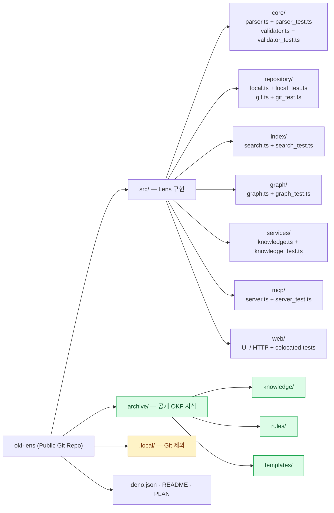
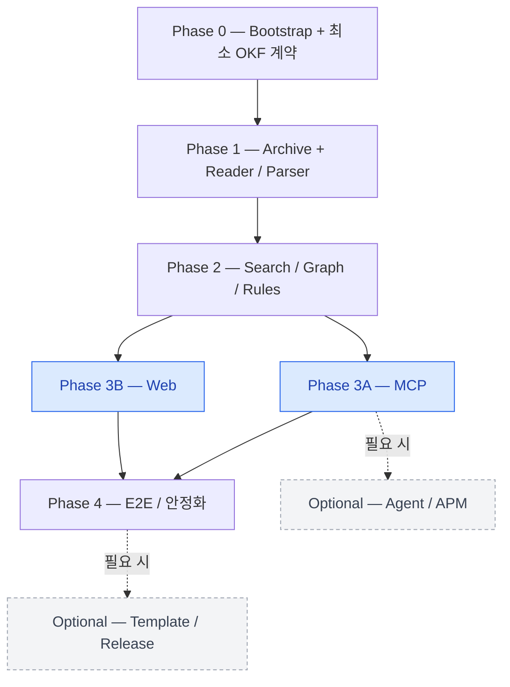
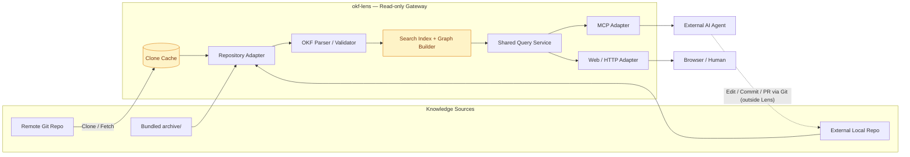

# PLAN.md — okf-lens

> Status: Draft · 2026-10-31  
> 이 문서는 **방향과 의존성을 공유하는 살아 있는 실행 계획**이다. 구현 상세·PR 단위·순서는 실사용을 통해 변경할 수 있다.

## 1. 목표

`okf-lens`는 **공개(Public) 단일 Git Repository**에서 서버 코드와 공개 OKF 지식(`archive/`)을 함께 개발하는 개인용 프로젝트다. 별도 `okf-archive` 저장소는 지금 만들지 않는다.

- `archive/`에 **실제 사용 가능한 지식**을 축적하면서 OKF 형식을 발전시킨다(Dogfooding).
- Lens는 로컬 경로 또는 원격 Git 기반 OKF 저장소를 **읽고, 파싱하고, 검색·관계 탐색하며, Web/MCP로 제공**한다.
- **Write API, 문서 편집, Commit/Push/PR 생성은 Lens의 책임이 아니다.** 작성·수정·승인은 로컬 Git 워크플로 및 외부 AI Agent가 수행한다.
- Agent 지침/스킬은 Lens 코드에서 분리한다. 필요할 때 `microsoft/apm`을 도입한다.
- 초기 배포는 Deno/TypeScript 기반의 단순한 로컬 실행을 가정한다. 별도 패키지, DB, 서비스, Template branch는 필요할 때 도입한다.

### 불변 원칙

1. **Git에 Commit된 지식이 Source of Truth**다. 인덱스·Graph는 재생성 가능한 파생 데이터다. 로컬 작업 트리를 읽는 개발 모드는 선택적으로 제공할 수 있다.
2. **Single Repo First, Logical Separation Always.** `archive/`는 기본 입력이지만 Reader/Parser가 그 경로에 하드코딩되어서는 안 된다.
3. **Public by Default.** `archive/`에는 공개 가능한 내용만 Commit한다. 비공개 콘텐츠·키·로컬 설정은 Git에서 제외한다. 공개 이력에 유출된 정보는 브랜치 변경만으로 사라지지 않는다.
4. **Read-only Interface.** Lens는 연결한 지식저장소를 편집하지 않는다. 자체 Git clone 캐시 및 검색 인덱스 작성은 허용한다.
5. **하나의 코어, 두 인터페이스.** Web과 MCP는 공통 조회 서비스를 사용한다.
6. **실제 사례 우선.** 불확실한 OKF 규격은 최소 계약으로 시작해 `archive/`의 사용 사례로 검증한다.

## 2. 초기 프로젝트 구조

```text
okf-lens/
├── src/
│   ├── core/                 # OKF Parser / Validator
│   │   ├── parser.ts
│   │   ├── parser_test.ts
│   │   ├── validator.ts
│   │   └── validator_test.ts
│   ├── repository/           # Local / Git Repository Adapter
│   │   ├── local.ts
│   │   ├── local_test.ts
│   │   ├── git.ts
│   │   └── git_test.ts
│   ├── index/                # Search Index
│   │   ├── search.ts
│   │   └── search_test.ts
│   ├── graph/                # Knowledge Graph
│   │   ├── graph.ts
│   │   └── graph_test.ts
│   ├── services/             # Web/MCP 공통 Read Service
│   │   ├── knowledge.ts
│   │   └── knowledge_test.ts
│   ├── mcp/                  # MCP Tools / Resources
│   │   ├── server.ts
│   │   └── server_test.ts
│   └── web/                  # Web UI / HTTP + 인접 테스트
├── archive/                  # Git 추적: 공개 Reference + 실제 OKF 지식
│   ├── knowledge/
│   ├── rules/
│   └── templates/
├── .local/                   # Git 제외: 로컬 설정/비공개 지식(선택)
├── .gitignore
├── deno.json
├── README.md
├── LICENSE
└── PLAN.md
```

> 디렉터리는 **초기 제안**이다. `apps/`, `packages/` 등 다중 패키지 구조는 실제 필요가 생기기 전에는 만들지 않는다. `archive/`는 개발용 Mock이 아닌 살아 있는 Reference Archive다.

### 프로젝트 구조 Mermaid



## 3. 테스트 구조 및 실행 원칙

- **Colocated Tests:** 테스트는 해당 구현 코드와 동일 디렉터리에 `*_test.ts`로 둔다. 최상위 `tests/`는 두지 않는다.
- **단위 테스트:** Parser, Validator, Adapter, Search, Graph, Query Service 등 각 모듈의 입력·출력과 예외를 독립적으로 검증한다.
- **통합 테스트:** 여러 컴포넌트가 연결되는 검증도 관련 기능 가까이에 `*_integration_test.ts`로 둔다. 범용 E2E 검증이 커지는 경우에만 구조를 다시 검토한다.
- **Fixture:** 작은 검증 데이터는 각 모듈의 `__fixtures__/`에 두고, 실제 `archive/`는 사용자 시나리오 검증에 사용한다. Archive의 변경으로 단위 테스트가 불안정해지지 않도록 분리한다.
- **Git 테스트 안전성:** 테스트에서 임시 Repository와 디렉터리를 사용하며 실제 사용자 작업 트리, 외부 원격 저장소, `.local/`을 변경하지 않는다.
- **검증 명령:** `deno test`, `deno fmt --check`, `deno lint`, `deno check`를 CI 기준으로 정한다. Deno 작업 설정은 `deno.json`에 모은다.
- 새 기능·버그 수정 PR에는 가능한 한 인접 테스트를 함께 포함한다. 테스트만을 위해 대규모 공통 프레임워크를 도입하지 않는다.

```bash
deno test
deno test src/core/parser_test.ts
deno test --coverage=coverage
```

## 4. Phase 및 PR 운영 규칙

- **서로 연결·종속된 작업은 하나의 Phase**로 묶는다. 각 Phase는 확인 가능한 기능적 결과와 완료 기준을 갖는다.
- **Phase 안에서는 Stacked PR**을 허용한다. 예: `main ← PR1(archive contract) ← PR2(parser) ← PR3(adapter)`.
- **독립된 작업은 병렬 Phase/PR**로 진행한다. Phase 번호 자체보다 그래프에 명시된 선행 조건이 우선이다.
- PR 하나는 가능한 한 리뷰·테스트 가능한 변경 단위로 만든다. 후속 PR 설명에는 `Depends on #...`을 명시하고, 선행 PR 병합 후 Base를 재설정한다.
- 한 Phase에 대한 모든 PR을 무조건 직렬화하지 않는다. 독립 PR은 같은 Phase에서도 나란히 진행 가능하다.
- **계획은 완벽하지 않다.** 변경 시 배경·의존성 변화·완료 기준 변화를 기록하되, Read-only·실사용 기반·공통 코어라는 방향은 유지한다.

## 5. Phase 로드맵

### Phase 0 — Bootstrap 및 최소 OKF 계약

**목표:** 프로젝트를 실행할 수 있고, 실제 문서 2~3개로 검증할 최소 문서 계약을 정한다.

- Deno/TypeScript 실행, Colocated Test(`*_test.ts`), 린트, 기본 CI 및 Public 문서/라이선스 정리
- `archive/` 기본 구조, 공개 가능한 초기 문서, 작성 규칙 초안
- 문서 ID/경로, Metadata, Link/Relation의 최소 표현 및 오류 처리 정의
- `.gitignore`로 `.local/`, 비밀값, 임시 캐시 제외

**PR Stack 예시:** `chore/bootstrap` → `docs/okf-minimum-contract` → `test/initial-archive`  
**Done:** 새 Clone에서 테스트가 동작하고, 샘플이 아닌 의미 있는 초기 OKF 문서를 사람이 읽을 수 있다.

### Phase 1 — Archive Dogfooding + Reader/Parser

**의존:** Phase 0  
**목표:** 실제 `archive/`를 Lens가 읽을 수 있게 만들고 규격을 함께 다듬는다.

- OKF 개념·아키텍처·결정사항 등 공개 지식 문서를 5~10개 수준으로 축적(숫자는 목표치가 아닌 가이드)
- Local Repository 읽기, 문서 파싱/검증, Metadata/Relation 추출
- Repository 경로를 설정으로 주입하고 `archive/` 외 경로도 읽는 테스트
- 파싱 오류를 격리하고 원본 파일을 수정하지 않는 정책
- 원격 Clone/Fetch는 기본 경로가 완성된 뒤 이 Phase 후반 또는 독립 후속 PR로 진행 가능

**PR Stack 예시:** `feat/archive-content` → `feat/local-reader` → `feat/okf-parser` → `test/reader-integration` (테스트 코드는 각 모듈 옆에 배치)  
**Done:** 실제 Archive 문서를 목록·상세 데이터로 읽고 오류를 보고할 수 있다. Reader는 `./archive`에 고정되어 있지 않다.

### Phase 2 — Search / Graph / Rule 조회 코어

**의존:** Phase 1  
**목표:** 동일한 데이터를 Web과 MCP가 쓸 수 있는 조회 서비스로 제공한다.

- 문서 목록/본문/Metadata/Rules/Templates 조회
- 단순 텍스트 검색 및 재생성 가능한 메모리 인덱스
- Relation 기반 Graph와 관련 문서 탐색
- 인덱스 갱신과 문서 변경 반영(초기에는 재시작·명시적 Refresh 가능)
- 외부 저장소에 대한 ID·경로 충돌 방지 전략

**PR Stack 예시:** `feat/query-service` → `feat/search` → `feat/graph` → `feat/rules`  
**Done:** 실제 `archive/`로 검색·관계 탐색·규칙 조회가 테스트되고, 공통 코어가 UI나 MCP에 종속되지 않는다.

### Phase 3A — MCP Read Interface

**의존:** Phase 2 · **3B와 병렬**  
**목표:** 외부 AI Agent가 Archive 지식을 소비할 수 있게 한다.

- MCP 서버 연결, 검색/문서/관계/규칙 조회 Tools
- 필요 시 Resources와 작성 가이드 Prompts
- `list_repositories`, `list_documents`, `get_document`, `search_knowledge`, `get_related_documents`, `get_knowledge_graph`, `get_repository_rules`를 후보 인터페이스로 검토
- 변경/Commit/PR 도구는 제공하지 않음

**PR Stack 예시:** `feat/mcp-server` → `feat/mcp-tools` → `test/mcp-e2e`  
**Done:** MCP 클라이언트가 실제 Archive를 검색·탐색할 수 있다.

### Phase 3B — Web Viewer / Graph Visualizer

**의존:** Phase 2 · **3A와 병렬**  
**목표:** 브라우저에서 공개 지식 문서와 관계를 탐색한다.

- Repository/문서 목록 및 본문 표시
- 검색 UI, 관련 문서 이동, Graph 시각화
- Rules/Templates 읽기 화면, 오류·빈 상태 처리
- 코어 구현 중복 없이 공통 서비스 사용

**PR Stack 예시:** `feat/web-shell` → `feat/document-viewer` → `feat/search-ui` → `feat/graph-ui`  
**Done:** 브라우저에서 실제 Archive의 문서를 찾고 관계 그래프를 탐색할 수 있다.

### Phase 4 — End-to-End / 공개 사용성 안정화

**의존:** Phase 3A 및 3B의 필수 결과  
**목표:** 처음 Clone한 사용자가 재현 가능한 방식으로 실행·탐색·연동한다.

- Web/MCP 동일 데이터 검증, 관련 모듈 가까이에 배치한 통합/E2E 테스트
- 외부 Local Repo 연결 및 Remote Git Clone/Fetch/Refresh의 미완성 부분 정리
- 안전한 저장소 경로/URL 처리, 비공개 데이터 노출 방지, 에러 진단
- 설치·설정·MCP 연결·Archive 작성/PR 예제 문서화
- 실제 병목 확인 시에만 인덱스 저장소/배포 구조 개선

**PR Stack 예시:** `test/e2e` → `feat/remote-sync` → `docs/quickstart`  
**Done:** 깨끗한 환경에서 설치 후 기본 Archive를 Web/MCP로 읽고, 외부 Repository도 연결할 수 있다.

### Phase 의존성 Mermaid



## 6. 내부 동작 아키텍처



**요청 흐름:** `Source → Adapter → Parser/Validator → Index/Graph → Shared Query Service → Web 또는 MCP`. 원본 저장소의 수정은 Lens 경로 밖에서만 일어나며, 갱신 후 인덱스를 재구축한다. 외부 에이전트의 파일 수정은 **에이전트가 접근 권한을 가진 실제 작업 트리**에서만 수행한다.

## 7. 선택적 후속 트랙 (현재 MVP 차단하지 않음)

| 트랙                                 | 시작 조건                      | 원칙                                          |
| ------------------------------------ | ------------------------------ | --------------------------------------------- |
| Agent 작성 Skill + `microsoft/apm`   | MCP 조회 규약이 안정화되면     | Lens에 작성 기능을 넣지 않음                  |
| 재사용 가능한 Validator CLI          | Parser/Validator가 안정화되면  | 미커밋 파일도 검사 가능                       |
| Template Branch 또는 GitHub Template | 외부 재사용 수요가 생기면      | 개인 Archive 이력·콘텐츠를 정리한 템플릿 제공 |
| Release Tags                         | 재현 가능한 버전이 필요하면    | Git Tag는 코드/Archive 스냅샷임을 명시        |
| 검색 저장소 및 원격 배포             | 실제 성능/운영 요구가 확인되면 | 단순한 구조를 우선                            |

## 8. 진행 상태

| Phase                         | 상태    | 필수 의존성 |
| ----------------------------- | ------- | ----------- |
| 0 — Bootstrap / Contract      | Planned | 없음        |
| 1 — Archive / Reader / Parser | Planned | 0           |
| 2 — Query / Search / Graph    | Planned | 1           |
| 3A — MCP                      | Planned | 2           |
| 3B — Web                      | Planned | 2           |
| 4 — E2E / Public Usability    | Planned | 3A, 3B      |

상태는 `Planned / In Progress / Blocked / Done`으로 갱신한다. 실제 PR 링크와 세부 작업 추적은 GitHub Issue/PR에 두고, 이 문서는 **전체 방향·의존성·완료 기준**만 유지한다.

## 9. 계획 변경 기준

- 현재 목표를 달성하는 데 필요하지 않다면 **새 저장소·새 패키지·새 서비스·새 DB를 추가하지 않는다**.
- 실제 지식 문서에서 새로운 요구를 발견하면 먼저 **Archive와 최소 OKF 계약**을 갱신할지 검토한다.
- 선행 작업이 필요한 변경은 해당 Phase/Stack에 넣고, 독립적인 작업은 병렬로 분리한다.
- 외부 Archive가 독립적으로 가치 있고 관리 비용을 감수할 이유가 생기면 `archive/`를 `okf-archive`로 추출할 수 있다.
- 계획을 수정할 때는 **변경 이유·영향받는 Phase/PR·유지되는 핵심 원칙**을 기록한다.
